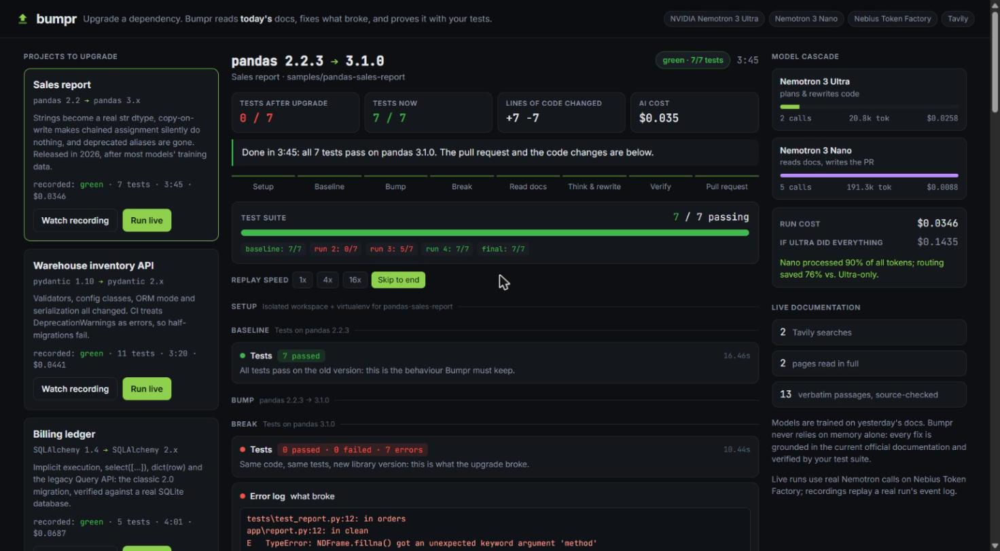
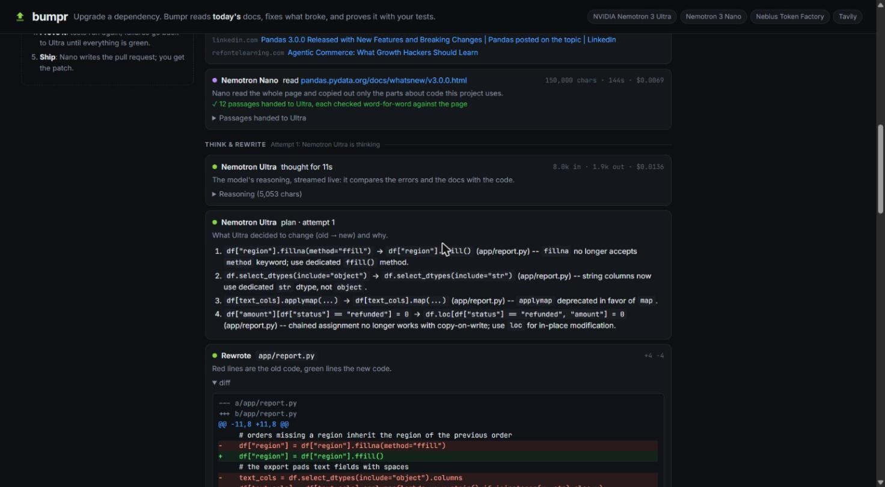
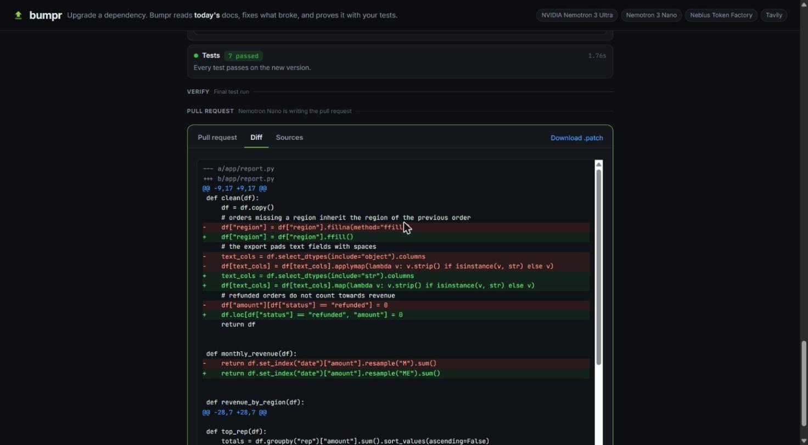
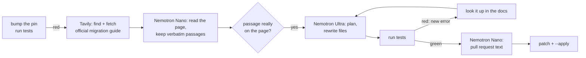

<h1 align="center">Bumpr</h1>

<p align="center">
  Upgrade a Python library and keep your code working.<br>
  Bumpr reads <b>today's</b> official docs, rewrites what broke with NVIDIA Nemotron,<br>
  and proves the fix with your own tests.
</p>

<p align="center">
  <a href="https://andrei-cicortas.github.io/bumpr/"></a>
  <a href="https://github.com/andrei-cicortas/bumpr/actions/workflows/test.yml"></a>
  
  <a href="LICENSE"></a>
</p>

<p align="center">
  
</p>

<p align="center"><sub>pandas 2.2 → 3.1: after the upgrade 0 of 7 tests pass. Bumpr gets all 7 green in under four minutes, for 3.5 cents.
<a href="https://andrei-cicortas.github.io/bumpr/">Watch this run in your browser</a>.</sub></p>

## Why I built it

Major-version upgrades are where codebases rot. pandas 3, pydantic 2 and SQLAlchemy 2 each break real code in
dozens of small ways, some of them silent: in pandas 3, strings become a new `str` dtype and chained assignment
quietly stops writing. The fixes are documented, but scattered across migration guides and "what's new" pages,
so the upgrade sits in the backlog for months.

AI coding assistants should be perfect for this, yet they fail in a specific way: **their training data predates
the release, so they confidently write the old API.** Asked to migrate a small pydantic model from memory, both
Nemotron 3 Super and Ultra kept `Field(regex=...)`, a keyword pydantic 2 removed. And someone still has to sit
there, prompt, check and re-prompt.

So I built the tool I wanted: one command that never trusts the model's memory. It reads the library's current
docs, rewrites the code, and only calls the job done when the project's own test suite is green.

## What it does

- **One command, then a reviewable change.** `bumpr . pandas --to 3 --apply` bumps the pin, fixes the code, and
  leaves you a `git diff`, a `.patch` and a pull request description that explains every change, with sources.
- **Reads the docs that exist today.** Tavily finds the library's official migration guide; NVIDIA Nemotron Nano
  reads the whole page and hands over only the passages your code needs, each one checked word for word against
  the page.
- **Thinks, then rewrites.** NVIDIA Nemotron Ultra plans every change (old → new, and why) and rewrites the files.
- **Proves it.** Your tests run again; failures go back to Ultra, and a new error is looked up in the official docs
  before the next attempt. Your files are only touched when every test passes.
- **Can't cheat.** Tests, requirements and test config are write-protected; shortcuts like `pydantic.v1`, warning
  filters or skipped tests are rejected.
- **Cheap, with hard caps.** A run costs a few cents on Nebius Token Factory; spend caps per run and in total are
  built in.

<table>
  <tr>
    <td width="50%"></td>
    <td width="50%"></td>
  </tr>
  <tr>
    <td><b>Docs first, then a plan.</b> Nano reads 150k characters of the official "What's new in 3.0.0" page and
    keeps 12 verified passages; Ultra turns them into a plan.</td>
    <td><b>A diff you can review.</b> Every changed line, plus the pull request text and the sources it used.</td>
  </tr>
</table>

## Install

1. `pip install git+https://github.com/andrei-cicortas/bumpr` (Python 3.10 or newer).
2. `bumpr setup` and paste two keys: a [Nebius Token Factory](https://tokenfactory.nebius.com) key and a
   [Tavily](https://app.tavily.com) key (the free tier is enough). They are stored only on your computer, in
   `~/.bumpr/.env`.

## Use it

Inside any Python project with a pytest suite and a `requirements.txt`:

```bash
bumpr . pandas --to 3 --apply        # --to latest | 3 | 3.1 | 3.1.0
```

Your project is never touched while Bumpr works: it runs on a copy in a throwaway virtualenv. When every test
passes, `--apply` writes the fixed files and the new pin into your project. You also get, in the current folder:

- `bumpr-pandas-3.1.0.patch`: every change, as a patch
- `bumpr-pandas-3.1.0.md`: the pull request description (what changed, why, sources)

Then it is the usual routine: read the description, `git diff`, commit, open the pull request.
Without `--apply` nothing in your project changes; you only get the patch and the description.

### In GitHub Actions

Bumpr also ships as an action that opens the pull request for you. Add your two keys as repository secrets
(`NEBIUS_API_KEY`, `TAVILY_API_KEY`), then `.github/workflows/bumpr.yml`:

```yaml
name: Upgrade with Bumpr
on:
  workflow_dispatch:
    inputs:
      package: { description: "Package", default: "pandas" }
      to: { description: "Target version", default: "latest" }
permissions:
  contents: write
  pull-requests: write
jobs:
  bumpr:
    runs-on: ubuntu-latest
    steps:
      - uses: actions/checkout@v4
      - uses: andrei-cicortas/bumpr@main
        with:
          package: ${{ inputs.package }}
          to: ${{ inputs.to }}
          nebius-api-key: ${{ secrets.NEBIUS_API_KEY }}
          tavily-api-key: ${{ secrets.TAVILY_API_KEY }}
```

The job fails, and no pull request is opened, unless every test passes. (In the repository settings, allow
GitHub Actions to create pull requests.)

## Results

| Migration | After the upgrade | After Bumpr | Time | Cost | Same calls on Ultra only |
|---|---|---|---|---|---|
| pandas 2.2 → **3.1** (released 2026) | 0 / 7 | **7 / 7** | 3:46 | $0.035 | $0.144 |
| pydantic 1.10 → 2.14 | 0 / 11 | **11 / 11** | 3:21 | $0.044 | $0.145 |
| SQLAlchemy 1.4 → 2.1 | 0 / 5 | **5 / 5** | 4:01 | $0.069 | $0.210 |

Recorded runs in `web/replays/`, replayable in the [demo](https://andrei-cicortas.github.io/bumpr/); costs use live
Token Factory prices. The three sample apps are in `samples/`.

## How it works



1. **Isolated sandbox.** The project is copied into a throwaway workspace with its own virtualenv (`uv`). The
   baseline must be green; then the dependency is bumped and the tests run again.
2. **Live documentation, grounded.** Tavily search finds the package's own migration guide; Tavily extract fetches
   the full page. Nemotron Nano (262k context, $0.06 per million input tokens) reads all of it and returns verbatim
   passages. A deterministic check keeps only passages whose lines really occur on the page, so the planner never
   sees "documentation" a model invented.
3. **Think, then rewrite.** Nemotron Ultra receives the code, the failing test lines and the excerpts, writes a
   migration plan and outputs complete new files. Its reasoning streams live into the web UI.
4. **Tests are the judge.** Failures go back to Ultra (up to 5 attempts). Ultra can ask for more docs with
   `NEED_DOCS: <query>`, and a new error is looked up in the official docs automatically.
5. **Ship.** Nemotron Nano writes the pull request description from Ultra's plan and the diff.

### Why two Nemotron models

| Job | Model | Why |
|---|---|---|
| Plan and rewrite code | `nvidia/Nemotron-3-Ultra-550b-a55b` | The hard reasoning, in 2-3 calls with a compact context |
| Read whole docs pages, extract passages | `nvidia/NVIDIA-Nemotron-3-Nano-30B-A3B` | Most tokens in a run are documentation; Nano reads them at 1/16 of Ultra's input price |
| Write the pull request | `nvidia/NVIDIA-Nemotron-3-Nano-30B-A3B` | Formatting, not reasoning |

Across the three recorded runs Nano processed 72-90% of all tokens, and the cascade cost 67-76% less than sending
the same calls to Ultra, while Ultra's context stays small (excerpts instead of 50k-character pages).

### What I learned building it

- **Agentic tool loops made Nemotron Ultra worse here.** The first version gave Ultra fine-grained tools
  (`read_file`, `replace_in_file`, `run_tests`, ...). It took 30+ short steps, reasoned only 30-100 tokens per step,
  and never got the pydantic sample green ($0.20-0.24 per failed run). "Think hard, rewrite whole files, let the
  tests judge" gave green runs in 2-3 Ultra calls for $0.03-0.07.
- **Small models should copy, not paraphrase.** With thinking off, Nano's *summaries* of the docs contained
  confident errors (e.g. "`each_item=True` is replaced by `mode='before'`") that derailed the planner. Verbatim
  passages, checked against the page, fixed it.
- **`chat_template_kwargs: {"enable_thinking": false}`** works on Token Factory for Nemotron 3 and makes Nano about
  5x faster for pure extraction; thinking stays on wherever accuracy matters.

## Web UI

The [demo](https://andrei-cicortas.github.io/bumpr/) replays real, unedited runs. To run it locally, with live runs:

```bash
git clone https://github.com/andrei-cicortas/bumpr && cd bumpr
pip install -e ".[web]"
cp .env.example .env            # add NEBIUS_API_KEY and TAVILY_API_KEY
uvicorn web.server:app --port 8000
```

`python -m web.build_static` rebuilds the static, recordings-only site in `docs/`.

## Configuration

| Variable | Default | Purpose |
|---|---|---|
| `NEBIUS_API_KEY` | - | Nebius Token Factory key (`bumpr setup` stores it) |
| `TAVILY_API_KEY` | - | Tavily key (`bumpr setup` stores it) |
| `NEBIUS_BASE_URL` | `https://api.tokenfactory.nebius.com/v1/` | OpenAI-compatible endpoint |
| `BUMPR_PLANNER_MODEL` | `nvidia/Nemotron-3-Ultra-550b-a55b` | Planner / code writer |
| `BUMPR_FAST_MODEL` | `nvidia/NVIDIA-Nemotron-3-Nano-30B-A3B` | Docs reader / PR writer |
| `BUMPR_MAX_RUN_COST` | `0.50` | Hard stop per run (USD, from live prices) |
| `BUMPR_MAX_TOTAL_COST` | `3.00` | Hard stop across all runs (ledger in `~/.bumpr/runs/spend.json`) |
| `BUMPR_ACCESS_CODE` | empty | If set, live runs in the web UI require this code |

Keys are read from environment variables first, then a `.env` in the current folder, then `~/.bumpr/.env`.

## Project layout

```
bumpr/
  __main__.py  CLI: bumpr setup, bumpr <repo> <package> --to <version> [--apply]
  agent.py     the upgrade loop (bump → test → docs → think & rewrite → verify → PR)
  docs.py      Tavily search/extract + Nano verbatim extraction + grounding check
  llm.py       Token Factory client: streaming reasoning, usage, live pricing, spend caps
  sandbox.py   isolated workspace + uv virtualenv + pytest runner
  tools.py     guarded file writes (tests/requirements protected, shortcuts rejected)
web/           FastAPI server, single-page UI, recorded runs
samples/       three small apps pinned to old majors, each with a pytest suite
tests/         offline unit tests (run in CI)
action.yml     the GitHub Action
```

## Nebius and NVIDIA usage

- **Nebius Token Factory** serves every model call through its OpenAI-compatible API: streamed reasoning traces,
  long-context calls (150k-character pages to Nano), and live per-token prices from `/v1/models?verbose=true`,
  used for the cost meter and the spend caps.
- **NVIDIA Nemotron 3 Ultra** (`nvidia/Nemotron-3-Ultra-550b-a55b`): planning and code generation.
- **NVIDIA Nemotron 3 Nano** (`nvidia/NVIDIA-Nemotron-3-Nano-30B-A3B`): documentation reading and the PR text.
- **Tavily**: `search` (advanced depth) to locate official docs and `extract` to fetch full pages, on every run.

## Limitations

- Python projects with a pytest suite and a `requirements.txt`; one dependency per run.
- The tests are the specification: a migration is only as safe as the suite that checks it.
- The GitHub Action is a thin wrapper around the CLI; the CLI itself is what the recorded runs and tests exercise.

## Licence

[MIT](LICENSE)
